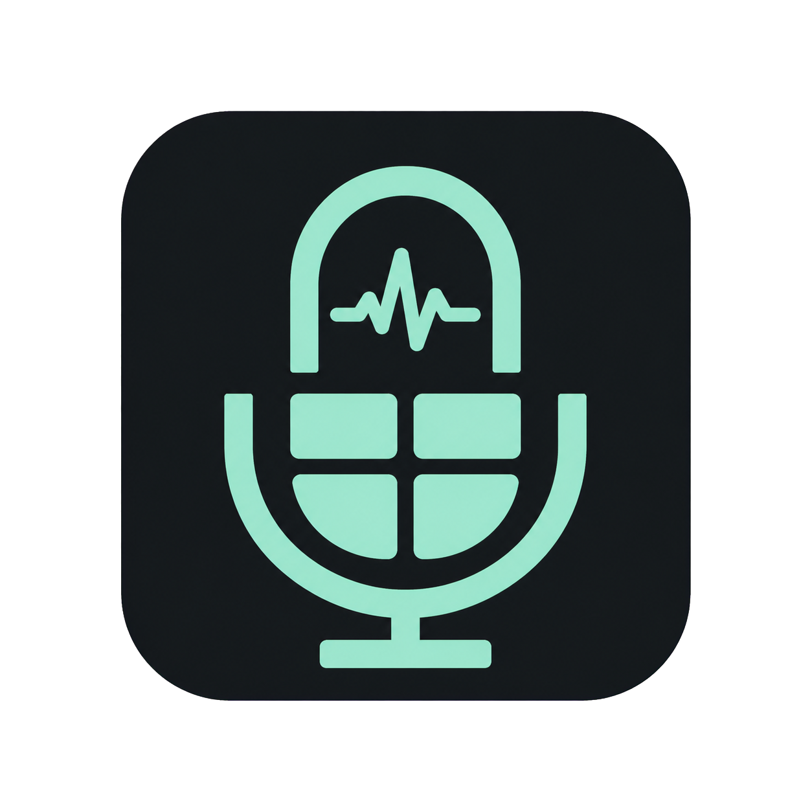

# OpenMicBoard

<p align="center">
  
</p>

OpenMicBoard is a local Windows soundboard that routes clips to a virtual audio device for use as a microphone in communication software.

## Requirements

- Windows 11, version 24H2 or later
- x64 or ARM64 Windows
- A virtual audio-cable driver or other virtual output device of your choice

OpenMicBoard does not bundle, endorse, or require a particular virtual-cable product.

## Quick start

1. Install and configure a virtual audio device using its vendor's instructions.
2. In OpenMicBoard, choose that device as the virtual output.
3. Optionally select your physical microphone in OpenMicBoard so voice and clips share the route.
4. In your call, streaming, or recording application, select the corresponding virtual-cable input as the microphone.
5. Add WAV, MP3, or OGG clips, then trigger them from the board or assigned hotkeys.
6. Create named profiles and use each pad's edit action to change its local display name, Fluent icon, and accent color.
   Use the trash action to remove a pad. Linked originals are never deleted;
   an unused managed copy is removed from OpenMicBoard's private library.
7. Use **Mix control** to level or boost the microphone, close idle noise with
   the noise gate, and raise quiet soundboard clips independently.
8. Use **Mute mic** whenever only soundboard playback should remain. The
   button mutes the selected Windows microphone endpoint, so it also works
   when another application currently uses that physical microphone.

Leave the microphone selector empty for a sound-only route. Check levels before joining a call; a clip can be much louder than expected.

Profile and pad appearance changes affect only the local board configuration.
Renaming a pad does not rename its source file or the shared sound asset.

Discord still controls its own Voice Activity threshold and voice processing.
OpenMicBoard's local voice leveling and noise gate provide a stronger, cleaner
mixed signal without leaving that threshold open on raw microphone noise.

The virtual output and private preview must not be the same physical playback
device when a microphone is selected. Doing so sends the delayed microphone
route back to your headphones and can combine with hardware sidetone, making
your voice sound doubled. Choose the virtual cable as **Virtual output** and
your headphones only as **Private preview**.

Triggering a pad also plays it through **Private preview**, when configured,
so the caller and the local user hear the same cue. If the route cannot start,
the cue can still play locally while the route status explains what is missing.

## Global shortcuts

Pads accept modifier chords such as `Ctrl+Alt+F1` and single global keys without
Ctrl or Alt. Supported single keys include `Numpad 0` through `Numpad 9`,
Numpad operators, `F1` through `F24`, navigation keys, letters, number-row keys,
and common media controls. Ordinary single keys are global while OpenMicBoard
runs, so assigning `A`, `Space`, or an arrow key can prevent that key from
reaching another application.

## Imports and storage

- **Managed import** copies a clip into OpenMicBoard's private library. It remains available if the original is moved or deleted. The library uses opaque file names so the original source path is not retained for the managed asset.
- **Linked import** keeps a reference to the existing file. It avoids a duplicate, but the tile becomes unavailable if the file is moved, renamed, or deleted.

Choose managed imports for portable, self-contained boards and linked imports for media you maintain elsewhere.

## Privacy and network behavior

OpenMicBoard is designed for local use. Audio processing, library storage, device selection, and hotkey handling happen on the device. It does not require an account or cloud service. Update checks are opt-in; keeping them disabled leaves the application offline. See [PRIVACY.md](PRIVACY.md) and [docs/privacy-and-data.md](docs/privacy-and-data.md).

## Unsigned downloads

Early or community builds may be unsigned. Windows SmartScreen can therefore show a warning. Only run builds obtained from a source you trust, verify the release information when available, and prefer building from this repository when you need an independently verifiable binary.

## Build from source

Install the .NET SDK and the Windows App SDK prerequisites appropriate for this solution, then run:

```powershell
dotnet restore OpenMicBoard.sln
dotnet build OpenMicBoard.sln -c Release
dotnet test OpenMicBoard.sln -c Release
```

The release script cross-publishes self-contained x64 and ARM64 packages:

```powershell
./scripts/Build-Release.ps1 -Version 1.0.0
```

See [docs/architecture.md](docs/architecture.md) for the project layout and
[docs/release-checklist.md](docs/release-checklist.md) for the automated and
hardware-dependent release gates.

## Community and support

Read [CONTRIBUTING.md](CONTRIBUTING.md), [CODE_OF_CONDUCT.md](CODE_OF_CONDUCT.md), [SECURITY.md](SECURITY.md), and [SUPPORT.md](SUPPORT.md) before participating.

## License

OpenMicBoard is licensed under the GNU General Public License, version 3 only. See [LICENSE](LICENSE).
